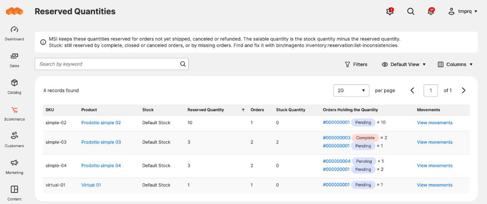
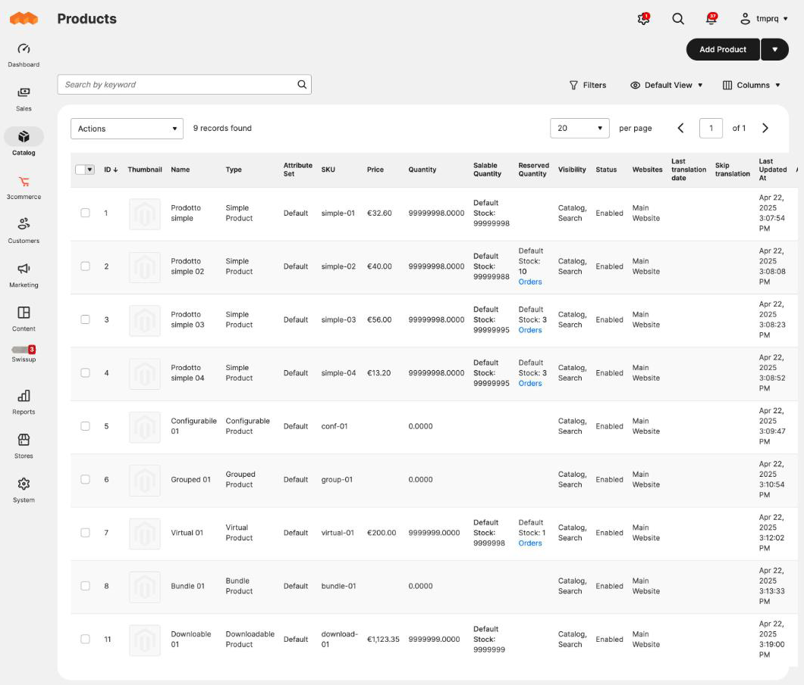
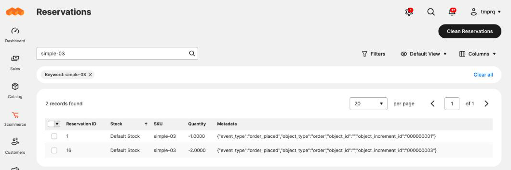

# Threecommerce_ReservedQty: MSI reserved quantities in the Magento 2 / Mage-OS admin

With MSI (Multi-Source Inventory) Magento does not lower the stock when an order comes in: it **reserves** the quantity and takes it off the salable quantity until the order is shipped, canceled or refunded. The admin never shows what is reserved or by which orders, only that the salable quantity is lower than the stock. This module shows it, and finds the quantities left **stuck** on orders that are already closed.



**Compatibility:** Magento Open Source / Adobe Commerce 2.4.4 – 2.4.9 · Mage-OS 1.x / 3.x / 4.x · PHP 8.1 – 8.4 · MSI enabled
**License:** free · **Current version:** see [Releases](../../releases)

## Features

- **Stores → Inventory → Reserved Quantities**: one row per SKU and stock with the quantity still reserved, linked to the product.
- The **orders holding the quantity**, each with a link, its status and its quantity.
- **Stuck quantity**: what is still reserved by complete, closed or canceled orders, by orders that no longer exist or by reservations without an order. These quantities lower the salable quantity for no reason; the core commands `inventory:reservation:list-inconsistencies` and `inventory:reservation:create-compensations` fix them.
- Keyword search on SKU and name, filters on stock and on quantity ranges, sorting on every number.
- A **Reserved Quantity** column in the product grid, next to Salable Quantity, with a link to the orders of that SKU.
- On Mage-OS, a link from each row to the single reservation movements in the native *Reservations* grid.
- Read only: it never creates, changes or deletes reservations. Own ACL resource for admin roles.





## Requirements

- Magento Open Source / Adobe Commerce 2.4.4+ or Mage-OS
- PHP 8.1 or newer, MySQL 5.7+ or MariaDB 10.2.3+
- MSI enabled: `Magento_InventoryReservations`, `Magento_InventoryAdminUi`
- Package: `threecommerce/m2-base`

## Installation

The module is free and distributed through our Composer repository at `repo.threecommerce.it`. Request the credentials from the [product page](https://www.threecommerce.it/quantita-riservate-msi-magento-2?utm_source=github&utm_medium=readme&utm_campaign=magento2-reserved-qty), then:

```bash
composer config repositories.threecommerce composer https://repo.threecommerce.it
composer require threecommerce/m2-reserved-qty
bin/magento module:enable Threecommerce_ReservedQty
bin/magento setup:upgrade
bin/magento cache:flush
```

## Configuration

None: after `bin/magento setup:upgrade` the grid is in the Stores → Inventory menu and the column is in the product grid. Access is granted per admin role with the *Reserved Quantities* resource.

## Documentation and support

- Product page and user guide (PDF): [threecommerce.it/quantita-riservate-msi-magento-2](https://www.threecommerce.it/quantita-riservate-msi-magento-2?utm_source=github&utm_medium=readme&utm_campaign=magento2-reserved-qty)
- [Changelog](CHANGELOG.md) (in Italian)
- Support and custom development: [threecommerce.it/contatti](https://www.threecommerce.it/contatti?utm_source=github&utm_medium=readme&utm_campaign=magento2-reserved-qty)

---

*This repository is the public showcase of the module. The source code is kept in a private repository.*
